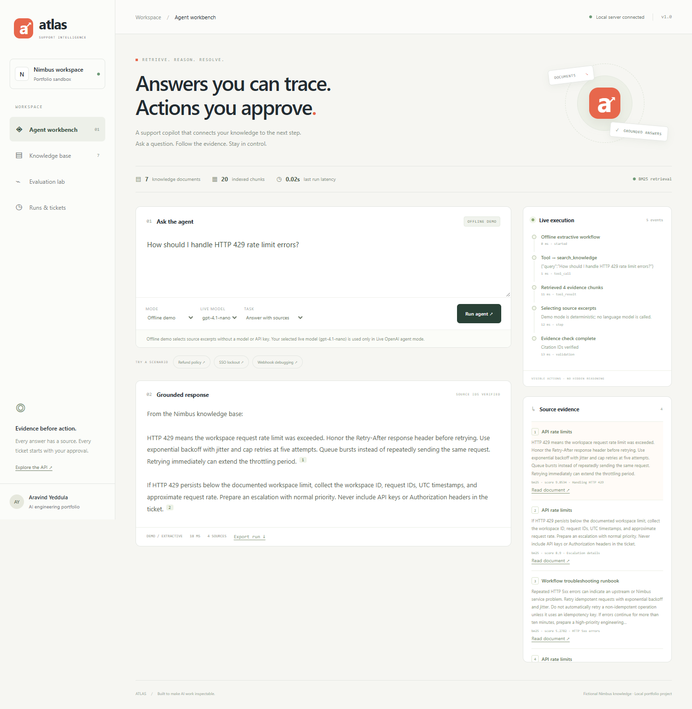
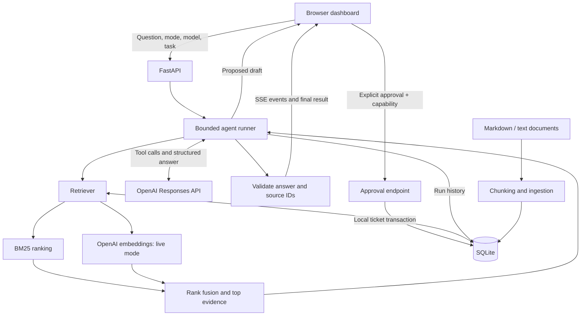
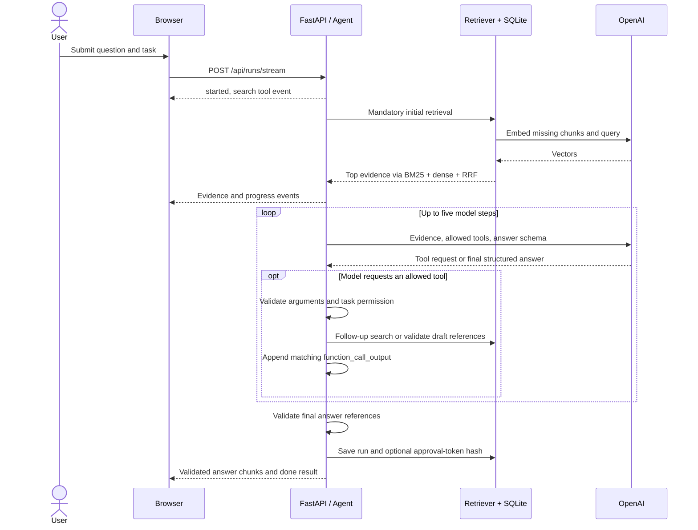
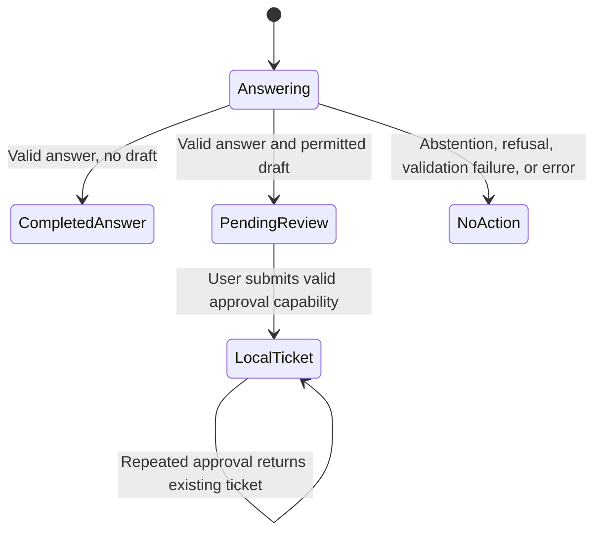

# Atlas — Agentic RAG Support Copilot

An AI engineering portfolio project that answers support questions from an indexed knowledge base, shows its retrieval and tool activity, and prepares escalation drafts for human approval.

**Python 3.12 · FastAPI · OpenAI Responses API · BM25 + embeddings · SQLite · Server-sent events**



Atlas uses the fictional Nimbus SaaS product as its support domain. The policies, incident history, and example questions are synthetic. You can run the complete offline workflow without an API key, then enable a real model and semantic retrieval with a server-side OpenAI key.

## Contents

- [Problem and capabilities](#problem-and-capabilities)
- [Quick start](#quick-start)
- [Configuration and model selection](#configuration-and-model-selection)
- [Architecture](#architecture)
- [Document ingestion and hybrid retrieval](#document-ingestion-and-hybrid-retrieval)
- [Agent loop, answers, and citations](#agent-loop-answers-and-citations)
- [Human approval and ticket creation](#human-approval-and-ticket-creation)
- [Streaming and observability](#streaming-and-observability)
- [API reference and examples](#api-reference-and-examples)
- [Persistence and project structure](#persistence-and-project-structure)
- [Testing and evaluation](#testing-and-evaluation)
- [Docker](#docker)
- [Troubleshooting](#troubleshooting)
- [Design decisions and limitations](#design-decisions-and-limitations)
- [Demo and interview preparation](#demo-and-interview-preparation)
- [Development roadmap](#development-roadmap)

## Problem and capabilities

A support assistant needs more than a fluent response. A reviewer needs to see which policy was retrieved, whether a tool ran, and whether a proposed action actually happened. Atlas makes that workflow inspectable through four dashboard views:

| View | What you can demonstrate |
| --- | --- |
| Agent workbench | Ask questions, choose a live model, inspect evidence, follow source links, and watch execution events |
| Knowledge base | Read the supplied documents or add Markdown/plain text and query it immediately |
| Evaluation lab | Run the labeled retrieval regression set and inspect individual hits and misses |
| Runs & tickets | Review saved runs and locally approved escalation tickets |

The main engineering features are heading-aware chunking, content-addressed embedding caching, hybrid rank fusion, bounded model tool use, structured answers with validated references, and a separate approval transaction.

### Two execution modes

| | Offline demo | Live OpenAI agent |
| --- | --- | --- |
| Retrieval | BM25 keyword ranking | BM25 + embedding similarity + reciprocal rank fusion |
| Answer | Deterministic excerpts from retrieved chunks | Model-generated paragraphs with structured source references |
| Tool decisions | Fixed workflow | Model-directed follow-up search and permitted escalation drafting |
| Credentials | None | Server-side OpenAI API key |
| Main purpose | Reproducible local demonstration and regression testing | Real retrieval-augmented generation and tool calling |

Offline mode is an extractive workflow; it does not call a language model or provide semantic retrieval. Live mode is a single-turn agent: it can take multiple tool steps within one request, but it does not remember a conversation across runs.

## Quick start

Requirements: **Python 3.12**, Git, and a modern browser. No Node installation or frontend build is required.

### Windows PowerShell

```powershell
git clone https://github.com/Aravindyeddula/support-agent-rag.git
cd support-agent-rag
py -3.12 -m venv .venv
.\.venv\Scripts\python.exe -m pip install -r requirements.txt
.\.venv\Scripts\python.exe -m uvicorn app.main:app --host 127.0.0.1 --port 8000
```

### macOS / Linux

```bash
git clone https://github.com/Aravindyeddula/support-agent-rag.git
cd support-agent-rag
python3.12 -m venv .venv
source .venv/bin/activate
python -m pip install -r requirements.txt
python -m uvicorn app.main:app --host 127.0.0.1 --port 8000
```

Open [http://127.0.0.1:8000](http://127.0.0.1:8000). The first start seeds seven knowledge documents, producing 20 chunks with the shipped corpus. Start with **Offline demo** and ask:

> How should I handle HTTP 429 rate limit errors?

Data is saved to `.data/atlas.sqlite3`. Existing documents are preserved on restart. After initial setup, Windows users can also launch the server with `./run.ps1` from PowerShell.

## Configuration and model selection

Copy the example environment file, edit `.env`, then restart the server:

```powershell
# Windows
Copy-Item .env.example .env
```

```bash
# macOS / Linux
cp .env.example .env
```

```dotenv
OPENAI_API_KEY=your-api-key-here
OPENAI_MODEL=gpt-4.1-mini
OPENAI_EMBEDDING_MODEL=text-embedding-3-small
# Optional: choose another local data directory
# ATLAS_DATA_DIR=.data
```

| Variable | Default | Purpose |
| --- | --- | --- |
| `OPENAI_API_KEY` | Empty | Enables live runs; remains on the server |
| `OPENAI_MODEL` | `gpt-4.1-mini` | Default response model |
| `OPENAI_EMBEDDING_MODEL` | `text-embedding-3-small` | Query and document embedding model |
| `ATLAS_DATA_DIR` | Project `.data` directory | Location of the SQLite database |

Existing process environment variables take precedence over `.env`. Relative data paths resolve from the server's working directory. Configuration is loaded at startup, so changes require a restart.

In the dashboard, select **Live OpenAI agent**, choose a **Live model**, and run a question. The configured options are `gpt-4.1-mini`, `gpt-4.1`, `gpt-4.1-nano`, plus your configured default if different. This list is an application allowlist; model availability depends on your API account. Selection applies to that run and is recorded in its result. The live model picker does not affect offline answers.

Live mode sends the question, retrieved document text, and tool results to OpenAI and incurs API usage. The first query also embeds uncached document chunks; later queries reuse those vectors. The UI reports model input/output tokens and embedding tokens. There is no built-in price calculator or spending cap. Responses calls request `store: false`; this does not establish that all provider-side retention is disabled.

`.env`, local databases, run history, virtual environments, and generated ZIPs are excluded from Git. Use fictional or public documents for a portfolio demo.

## Architecture

The browser and API are served by the same FastAPI application. Retrieval, the agent loop, and approval rules remain in Python; the frontend renders events and submits user choices.



### One live request



For module responsibilities and additional tradeoffs, see [docs/ARCHITECTURE.md](docs/ARCHITECTURE.md).

## Document ingestion and hybrid retrieval

### 1. Ingest and chunk

The ingestion endpoint accepts a title of 3–120 characters and a Markdown/plain-text body of 40–60,000 characters. It does not fetch URLs or parse PDFs.

1. Split text at Markdown headings and retain the document title and section name.
2. Divide long sections into windows of at most **150 words**, with **25 words of overlap**.
3. Produce deterministic 12-character chunk IDs from document identity, position, and text.
4. Compute content fingerprints that include title, section, and chunk text.
5. Replace a changed document's old chunks in one transaction. Re-ingesting an unchanged title and body is idempotent.

The API derives custom document identity from its title. Submitting the same title updates that document; a different title creates another document. Chunk IDs are stable for identical inputs, but edits or changed chunk positions can change IDs. Saved runs keep their evidence snapshots.

### 2. Lexical retrieval: BM25

The retriever lowercases text, extracts alphanumeric tokens, and removes a small stopword set. BM25 ranks title, heading, and body tokens using term frequency, inverse document frequency, and document-length normalization. The implementation uses `k1 = 1.5` and `b = 0.75`; repeated query tokens are deduplicated.

BM25 is useful for exact terms such as `HTTP 429`, `SSO`, and policy names. Offline mode returns the top four chunks with positive scores. A positive lexical match is a ranking signal, not a calibrated confidence score.

### 3. Semantic retrieval: embeddings

In live mode, the retriever embeds title + heading + chunk content and ranks vectors by cosine similarity to the embedded query. Missing document vectors are requested in batches of 32 and cached in SQLite by `(content fingerprint, embedding model)`. The query is embedded on every search.

The current dense retrieval floor is **0.20 cosine similarity**. This is a demo heuristic, not a probability that the answer is correct. Vectors are scanned in process; no external vector database or approximate nearest-neighbor index is used.

### 4. Combine rankings with reciprocal rank fusion

BM25 scores and cosine similarities use different scales. Atlas combines their ranks rather than adding raw scores:

```text
RRF(chunk) = sum over retrievers of 1 / (60 + rank(chunk))
```

Each retriever contributes up to 20 candidates. A chunk appearing in both lists receives both contributions, and the top four fused chunks become evidence. Follow-up searches can add more evidence to the same run. Changing the embedding model creates a separate cache namespace; unchanged text does not need to be re-embedded for the same model.

## Agent loop, answers, and citations

Every request starts with application-enforced retrieval. In live mode, the model then chooses between producing an answer and calling one of two tools:

| Tool | Inputs | Enforced behavior |
| --- | --- | --- |
| `search_knowledge` | `query` | Searches the local corpus and adds returned evidence to the run |
| `draft_escalation` | `title`, `summary`, `priority`, `evidence_ids` | Proposes a draft only if the selected task permits drafting and all references were retrieved |

Pydantic validates argument shape and length and rejects extra fields. Unknown tools are rejected. The application permits at most **five model steps** and **four tool calls per step**; invalid calls return a bounded error to the model. Tool results carry the matching call ID. There is no shell, browser, email, payment, or account-management tool.

### Structured answer contract

The final model response must match a strict JSON schema. A simplified example is:

```json
{
  "status": "answered",
  "claims": [
    {
      "text": "Honor the Retry-After response header before retrying.",
      "source_ids": ["<retrieved-chunk-id>"]
    }
  ]
}
```

The example ID is a placeholder. In a real request, the schema restricts `source_ids` to IDs actually retrieved during that run and refreshes that list after follow-up searches. Server validation additionally requires nonempty claim text, valid references, and at most six claims. The application renders the citation brackets and links after validation.

An invalid or incomplete response gets at most **one format-repair attempt**, within the existing five-step budget. The UI distinguishes these outcomes:

| Outcome | Meaning |
| --- | --- |
| `answered` | A response with valid retrieved source references was produced |
| `insufficient_evidence` | Retrieval returned no evidence, or the model explicitly abstained |
| `validation_failed` | Evidence existed, but a valid final response was not obtained |
| `refused` | The model declined the request |

Provider failures are reported as failed runs, separately from these completed outcomes. Citation checks establish **source-ID provenance**, not semantic entailment: a valid reference does not prove that its paragraph supports every claim. Human review and a separate answer-quality evaluation remain necessary.

## Human approval and ticket creation

Selecting **Prepare escalation draft** authorizes a proposal. It does not authorize the model to create a ticket.



A completed draft receives a random approval capability. Only its SHA-256 hash is stored with the run; the capability is returned to the initiating browser and kept in `sessionStorage`. The separate approval endpoint checks it using a constant-time comparison, then creates a local ticket inside a transaction. A unique `run_id` constraint prevents duplicate tickets on repeat approval.

The draft tool cannot invoke approval. There is no Jira/Zendesk integration and no external message is sent. The capability is specific to a run; it does not replace user authentication in a shared application. If the browser loses the capability, the history endpoint cannot recover it—create a new draft from the question.

## Streaming and observability

The API sends server-sent event frames over a POST response. The frontend uses `fetch` and a streaming reader because native `EventSource` does not send the request body needed here.

Events include `started`, `tool_call`, `tool_result`, `step`, `validation`, `answer_delta`, `done`, and `error`. They expose tool arguments, retrieved evidence, elapsed time, model selection, and usage counters. They do not expose private chain-of-thought.

Execution events stream as work completes. Final model text is buffered for validation and then delivered in 90-character chunks. This is **not upstream model-token streaming**. Stopping the browser request closes the stream, but an in-flight provider request may finish before cancellation reaches it.

Provider HTTP calls have a 45-second timeout and up to three attempts for transient HTTP statuses, with bounded exponential backoff. The API allows three active runs per process. These controls limit the demo's execution; they are not production rate limiting or an account spending cap.

## API reference and examples

The machine-readable schema is available at [`/openapi.json`](http://127.0.0.1:8000/openapi.json) while the server runs.

| Method | Endpoint | Purpose |
| --- | --- | --- |
| GET | `/api/health` | Version, configured models, live-mode readiness, document/chunk counts |
| GET | `/api/documents` | List indexed documents |
| GET | `/api/documents/{doc_id}` | Read a document |
| POST | `/api/documents` | Ingest or replace a custom text document |
| POST | `/api/runs/stream` | Start a question and receive SSE events |
| GET | `/api/runs` | Latest 50 saved runs; no approval capability is exposed |
| POST | `/api/runs/{run_id}/approve` | Approve a completed draft using its capability |
| GET | `/api/tickets` | List locally created tickets |
| GET | `/api/evaluation` | Evaluate BM25 on the current database |

Example requests using Python, with the server running:

```python
import json
import httpx

base = "http://127.0.0.1:8000"

# Add a fictional document. The same title updates it on subsequent submissions.
response = httpx.post(f"{base}/api/documents", json={
    "title": "Demo sandbox policy",
    "content": "# Demo sandbox policy\nSandbox workspaces expire after 14 days. "
               "Owners can request a new workspace from the internal demo team."
})
response.raise_for_status()
print(response.json())

# Parse the one-line JSON data records emitted by Atlas.
with httpx.stream("POST", f"{base}/api/runs/stream", timeout=180, json={
    "question": "When does a sandbox workspace expire?",
    "mode": "demo",       # Use "live" after configuring a server-side API key.
    "allow_draft": False  # Set True to permit an escalation proposal.
}) as stream:
    stream.raise_for_status()
    for line in stream.iter_lines():
        if line.startswith("data: "):
            event = json.loads(line[6:])
            if event["type"] == "answer_delta":
                print(event["text"], end="", flush=True)
```

For live requests, optionally include `"model": "gpt-4.1-mini"`. Only configured model choices are accepted. To approve a draft, POST `{"token": "<approval_token from done event>"}` to its run's approval endpoint. Treat that capability as private and do not put it in a public example or URL.

Validation errors normally return HTTP 422; unsupported models and missing live credentials return 400; invalid approval capabilities return 403; runs without a completed draft return 409; a full local run gate returns 429. Once an SSE response starts, later execution failures arrive as `error` events, so a client must inspect the stream as well as its initial HTTP status.

## Persistence and project structure

SQLite keeps the application self-contained:

| Table | Stored data |
| --- | --- |
| `documents` | Source title, body, fingerprint, and update time |
| `chunks` | Chunk ID, document ID, heading, text, and fingerprint |
| `embeddings` | Vectors keyed by content fingerprint and embedding model |
| `runs` | Question, mode, execution status, result snapshot, and optional approval hash |
| `tickets` | Approved title, summary, priority, evidence IDs, and unique originating run |

Questions, source text, run results, and tickets persist locally. This version has no retention or deletion UI. For a clean independent demo, stop the server and start it with `ATLAS_DATA_DIR` pointing to a new directory. Preserve the existing directory if you need its history. Seed files are loaded only when the database has no documents; editing a seed file does not automatically replace an existing database document.

```text
app/
  main.py          FastAPI routes, request limits, SSE, local browser boundary
  config.py        Environment configuration and model allowlist
  retrieval.py     Ingestion, chunking, BM25, cosine search, rank fusion
  provider.py      OpenAI HTTP adapter, structured output, retries, usage
  agent.py         Tool definitions, bounded runner, citations, draft rules
  store.py         SQLite schema, transactions, cache, runs, approval
  evaluate.py      Reproducible offline retrieval evaluator
web/               Dashboard HTML, CSS, and browser JavaScript
data/knowledge/    Seven fictional Nimbus source documents
data/eval_cases.json
tests/             Behavioral tests and provider protocol mocks
scripts/           Browser/live smoke checks and source ZIP helper
docs/              Architecture, demo, learning guide, verification, screenshots
reports/           Retrieval baseline and latest live smoke report
.github/workflows/ci.yml
```

## Testing and evaluation

Install development dependencies into the same environment:

```bash
python -m pip install -r requirements-dev.txt
python -m pytest
python -m app.evaluate
```

On Windows without activating the environment, replace `python` with `.\.venv\Scripts\python.exe`.

### Retrieval baseline

The CLI evaluator uses a temporary database seeded only with the shipped corpus. The dashboard endpoint instead evaluates the current application database, so added documents can change its results.

| Metric | Definition | Recorded baseline |
| --- | --- | --- |
| Hit rate@4 | Fraction of answerable questions with a relevant document among the first four chunks | 1.000 |
| MRR@4 | Mean reciprocal rank of the first relevant document, zero if absent | 1.000 |
| No-evidence accuracy | Fraction of out-of-scope questions returning no chunks | 1.000 |

The set contains **14 synthetic cases: 11 answerable and 3 out of scope**. Relevance is checked at document level using the returned chunk order. Results are in [reports/retrieval.json](reports/retrieval.json).

This small set was authored alongside the corpus. It is a regression baseline, not an independent benchmark. It evaluates BM25 retrieval only; it does not measure hybrid retrieval quality, generated-answer correctness, semantic citation support, or production accuracy.

### Verification performed

**43 Python tests passed** locally. They cover ingestion replacement, retrieval, cache reuse, tool authorization, malformed calls, bounded loops, source-reference validation, one-shot repair, refusals, incomplete outputs, model selection, provider errors, and idempotent approval. Provider protocol tests use scripted doubles and HTTP mocks.

Real browser smoke checks exercised answering, source navigation, model selection, missing-key guidance, drafting/approval, ingestion, safe text rendering, evaluation, history, and mobile overflow. No application JavaScript console errors were observed in those checks.

Live OpenAI smoke checks answered the HTTP 429 question using all three picker models. Three additional consecutive `gpt-4.1-mini` checks passed. These are functional checks of one question, not a model comparison or quality benchmark. See [the verified live answer](docs/live-answer.jpg), [latest live report](reports/live-smoke.json), and [verification details](docs/VERIFICATION.md).

### Optional checks

```bash
# Browser checks: install Chromium, then run against an isolated temporary database.
python -m playwright install chromium
python scripts/browser_check.py --channel chromium

# Live check: requires the running server's key and incurs API usage.
python scripts/live_check.py --models gpt-4.1-mini --repeats 3

# Create a source-only ZIP beside the project directory.
python scripts/package.py
```

The browser check does not use your configured key. The ZIP helper excludes credentials, databases, virtual environments, Git metadata, and caches. GitHub Actions is configured to run Python tests and the offline evaluation on pushes and pull requests without a model key; the retrieval report is uploaded as an artifact.

## Docker

```bash
docker build -t atlas-rag .

# Offline, with persistent local data
docker run --rm -p 127.0.0.1:8000:8000 -v atlas-data:/app/.data atlas-rag

# Live, using the local environment file
docker run --rm -p 127.0.0.1:8000:8000 --env-file .env -v atlas-data:/app/.data atlas-rag
```

The image uses Python 3.12 and a non-root user. Binding the host port to `127.0.0.1` keeps the demo local. Docker build and hosted deployment have not been verified in this workspace.

## Troubleshooting

| Symptom | What to check |
| --- | --- |
| Live mode asks for a key | Edit the project-root `.env`, ensure `OPENAI_API_KEY` is nonempty, and restart. `/api/health` should show `live_available: true`; it never returns the key. |
| Changing `.env` has no effect | Configuration is loaded at startup. An existing process environment variable also takes precedence over the file. |
| Cannot use a model | Choose live mode and a configured model. Account access is checked by OpenAI at request time; a picker option is not an access guarantee. |
| HTTP 401 / authentication error | Confirm that the key is valid in your own API account. Keep it out of browser forms, screenshots, source control, and issue reports. |
| HTTP 429 | Distinguish the local three-run concurrency gate from a provider rate/quota error. Wait for active runs or check your API account's quota and limits. |
| Connection error or timeout | Check server network access, proxy/firewall settings, and provider availability. Finite retries cannot fix blocked outbound access. |
| “Insufficient evidence” | Inspect retrieved sources. Try a question covered by the Nimbus documents or ingest relevant text. Offline mode needs lexical overlap. |
| “Response validation failed” | Relevant sources were found, but the generated output did not pass the answer contract. Retry and inspect the execution trace; this is different from missing evidence. |
| Old citation behavior after updating code | Stop the old server, restart from this checkout, and refresh the browser. `/api/health` should include `response_contract: claims-v1`. |
| New seed text is missing | Seed files are only loaded into an empty corpus. Re-ingest a custom document or use a new data directory. |
| Approval fails after reopening the browser | The per-run capability may have been lost from session storage. Generate a new draft; saved history does not expose capabilities. |
| Port 8000 is busy | Stop the older instance or choose another port with `--port`. Update the browser URL and script `--url` accordingly. |

## Design decisions and limitations

| Decision | Why it is useful here | Tradeoff |
| --- | --- | --- |
| Plain Python agent loop | Makes tool execution, limits, and failure paths easy to inspect | More orchestration code to maintain than a framework abstraction |
| SQLite and in-process vector scan | No external services needed for a small runnable demo | Retrieval scans the corpus; larger deployments need indexed retrieval |
| BM25 + dense + RRF | Combines exact-term matching with semantic similarity without mixing score scales | Thresholds and candidate counts require held-out evaluation |
| Structured final claims | Application owns citation rendering and rejects unknown references | Valid source IDs do not establish factual support |
| Buffered final answer | Citation validation finishes before generated claims are shown | Longer wait before answer text appears |
| Separate approval endpoint | Keeps model proposals separate from application state changes | A shared deployment still needs real identity and authorization |
| Same-origin vanilla frontend | Minimal setup and direct visibility into the SSE client | No frontend framework or build-time type checking |

This is a **single-user local portfolio application**. It has no login, tenant isolation, distributed rate limiter, worker queue, retention manager, or real ticket adapter. Same-origin write checks, safe DOM rendering, a Content Security Policy, explicit tool validation, and approval capabilities provide useful local boundaries; they do not make an unauthenticated deployment production-ready. Non-browser clients can call the API.

Retrieved text is treated as untrusted data in the prompt. Prompt instructions alone do not solve prompt injection. The enforced limits are the tool allowlist, server-side argument checks, drafting permission, bounded execution, and separate approval path. Live-model injection resistance has not been systematically evaluated.

## Demo and interview preparation

Use [docs/DEMO.md](docs/DEMO.md) for a presentation script and [docs/LEARNING_GUIDE.md](docs/LEARNING_GUIDE.md) to study the implementation.

1. Ask the HTTP 429 question and open a source citation.
2. Switch between offline and live mode and explain the retrieval difference.
3. Ask about administrators locked out after an SSO change with drafting enabled.
4. Show the proposed escalation and approve it; verify exactly one local ticket.
5. Add a fictional policy and ask about a fact unique to it.
6. Run the retrieval evaluation and explain what its perfect score does and does not measure.

Be ready to explain why chunk overlap exists, how the cache invalidates, why rank fusion is used, what makes tool use agentic, why citation validity differs from factuality, and how approval idempotency works. Reproduce the checks and make your own changes before presenting the project as work you can independently maintain. Describe AI assistance honestly and avoid claiming production usage or an independent accuracy benchmark.

## Development roadmap

The following are proposed extensions, not implemented features:

- Build a held-out paraphrase set and compare BM25, dense retrieval, and RRF under the same evaluation.
- Grade generated answers for correctness, unsupported claims, citation entailment, abstention, and escalation quality.
- Add adversarial documents and live-model prompt-injection tests without broadening the tool permissions.
- Measure cold/warm embedding latency and retrieval performance as the corpus grows.
- Move retrieval to a vector index such as pgvector when measurements justify it.
- Add authentication, tenant-aware authorization, request quotas, retention controls, and background jobs before a shared deployment.
- Add a real ticket-system adapter behind the existing human approval boundary, with idempotency keys and audit records.

## References

- [OpenAI function calling](https://developers.openai.com/api/docs/guides/function-calling)
- [OpenAI embeddings](https://developers.openai.com/api/docs/guides/embeddings)
- [OpenAI structured outputs](https://developers.openai.com/api/docs/guides/structured-outputs?api-mode=responses)
- [FastAPI streaming responses](https://fastapi.tiangolo.com/advanced/stream-data/)

Created for [Aravind Yeddula](https://github.com/Aravindyeddula)'s AI engineering portfolio.
