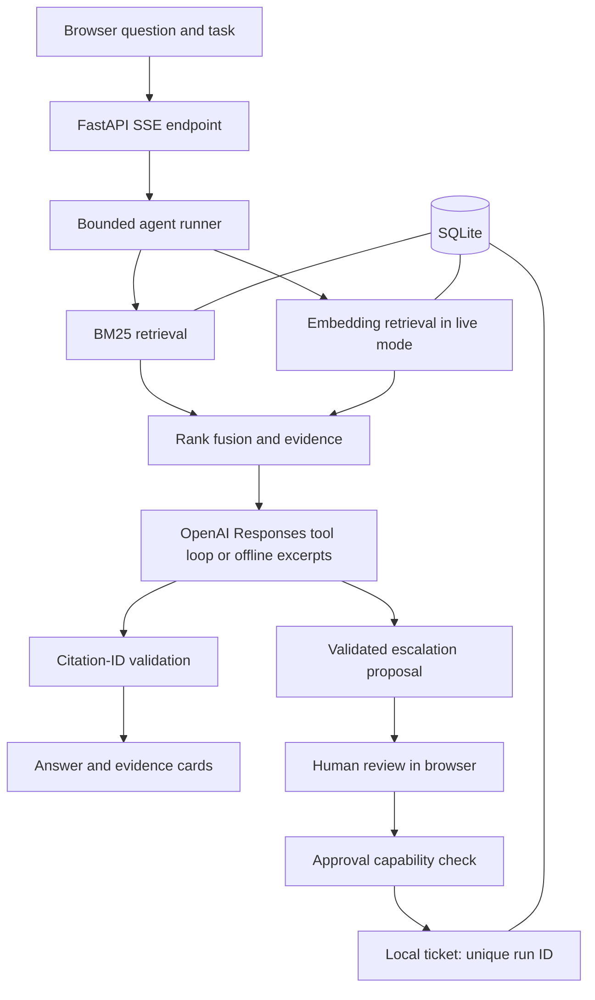

# Architecture and decisions

## Data flow

## Retrieval

Documents are split at Markdown headings into overlapping windows capped at 150 words, with 25 words of overlap. Chunk IDs include the document ID, position, and text hash. Each chunk also has a content fingerprint for the embedding cache. Updating a document atomically replaces old chunks. Unchanged content is not indexed twice.

BM25 uses query-term frequency, inverse document frequency, and length normalization. In live mode, the query and uncached chunks are embedded. Cosine similarity ranks vectors, with a basic 0.20 similarity floor. Reciprocal rank fusion combines the top 20 candidates from each retriever using `1 / (60 + rank)`, then returns the top four. The floor is a demo heuristic, not a calibrated confidence estimate.

SQLite stores documents, chunks, cached vectors, runs, and approved tickets. Vectors are namespaced by embedding model and content fingerprint. The implementation is intentionally readable and works for a small corpus. It does not claim indexed nearest-neighbor performance.

## Agent and tools

Every run starts with a retrieval call. Live mode then passes evidence and the user question to a model. The model may call `search_knowledge` or `draft_escalation`. Tool arguments are parsed and validated with Pydantic; unknown tools are rejected. All tool outputs are returned with their matching function call IDs. The loop stops after five steps.

The initial search is enforced by the application, while follow-up tool selection is model-directed. Offline mode follows a deterministic search/excerpt workflow and does not call a language model. The event stream reports actions and outputs, not private chain-of-thought.

Final answers use a strict JSON schema containing a status and an array of paragraphs with `text` and `source_ids`. The allowed source IDs are supplied as an enum and refreshed after follow-up searches. Server-side validation requires nonempty text and known references before rendering citation brackets and links. The model does not format citation syntax. An invalid response gets at most one format-repair attempt within the existing step budget. Refusals, insufficient evidence, and validation failures have separate outcomes.

## Approval boundary

The draft tool cannot write a ticket. It checks the explicit task authorization and verifies that every evidence ID was retrieved. A completed draft receives a random approval capability; its hash is stored server-side. The browser receives the capability only with the completed run, stores it for that session, and submits it after the user clicks approval. The approval transaction checks the capability and a unique `run_id` constraint makes repeated approvals idempotent.

There is no real Jira, Zendesk, payment, email, account, or identity integration. This project enforces a useful action boundary, but does not substitute for authentication and role-based authorization in a shared deployment.

## Streaming and errors

FastAPI sends SSE records over a POST response. Searches, model steps, tool results, and validation events are sent when those actions complete. The browser incrementally parses frames across arbitrary network chunk boundaries. Final text is buffered until citation validation, then displayed through response chunks. There is no artificial latency or fake token timing.

Upstream requests use timeouts, bounded exponential retry for transient statuses, and sanitized errors. The UI separates failed runs from valid abstentions. SQLite preserves completed and failed run states. Browser disconnects may take time to reach a blocked provider request.

## Evaluation interpretation

The shipped evaluation measures document hit rate at four retrieved chunks and reciprocal rank of the first relevant document. For out-of-scope questions it checks whether retrieval returns no evidence. It does not evaluate generated answer correctness, semantic citation entailment, prompt-injection resistance of a live model, or ticket quality. Results are based on a corpus-authored regression set, so high scores are expected.

Useful next experiments: hold out paraphrases before tuning, compare BM25 versus dense versus fusion, measure retrieval latency at larger corpus sizes, grade unsupported claims with a human rubric, and test malicious document instructions against a live model without granting additional tools.
